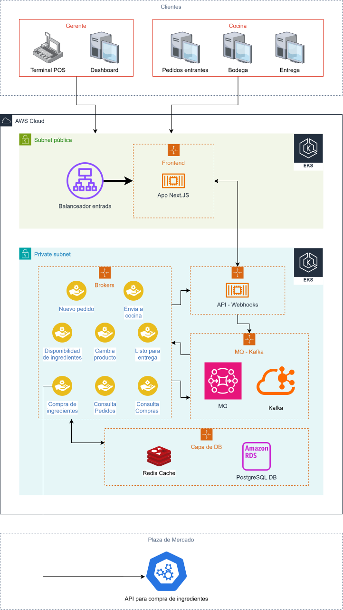
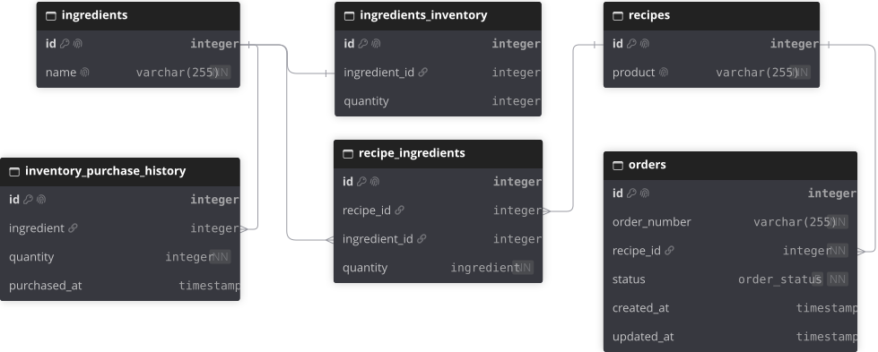

# Proceso de planificación del software

## Requisitos Técnicos y limitaciones de tecnología

### Backend

1. Se debe diseñar una api con Node.js de forma nativa por medio de la cual el front interactua para hacer los pedidos, generar nuevos pedidos, ver pedidos existentes, recetas disponibles e inventario restante. Interfaz principal REST del lado del front (client), asyncrono y Webhooks para actualización de datos desde externos (brokers).

2. Se debe diseñar microbrokers para exponer a la API con las siguientes capacidades:
    - Resistencia a fallos (Alta disponibilidad).
    - Replicación en alto consumo (Orquestación de recursos).
    - Designados a una única tarea (Un proceso fallido no debe de afectarme ningún otro estado u operación en la aplicación).
    - Diseñado con bajo consumo de recursos en mente, en caso de ser posible con serverless con bajo coldStart.
3. Se debe disponer de un sistema de mensajería asíncrono con alta disponibilidad para permitir despliegues multi-Rack y/o multi A-Z, entre los candidatos se considera:
    - BlazingMQ (configuración en Cluster, centralizada en Colas y Mensajes).
    - Apache Kafka (configuración ISR, centralizada en eventos).
4. Base de datos para guardar las recetas, pedidos en cola, pedidos en curso, pedidos entregados, inventario, compras de insumos, entre los candidatos se considera:
    - SQLite (local y mono nodo, para testing local funcionaría, dificil de hacer de alta disponibilidad).
    - PostgreSQL (Despliegue con Sharding para crecimiento horizontal).
    - AWS RDS (Nativa de la nube, preconfigurada).
5. Sistema de caché sobre la base de datos para aliviar operaciones de I/O, entre los candidatos se considera:
    - Redis (Sharding y ClusterAgnostic).
    - DragonflyDB (Sharding, Cluster y bajo consumo de recursos).

### Frontend

Se requiere acceso con autenticación del gerente, se generará una capa de seguridad (proxy), adicional se requiere ver en tiempo real los pedidos e inventario, se usará un framework con capacidad de SSR, CSR, SSE para entregar una experiencia rápida y responsiva, el candidato ideal para este despliegue mínimo es Next.JS

### Code Coverage, deuda técnica y vulnerabilidades

Validación de código y vulnerabilidades, las herramientas dedicadas a este proceso serán fijas desde el inicio dentro del mono-repo y se manejaran en los dashboards como proyectos independientes (back, brokers y front como proyectos independientes para permitir multiples equipos trabajar en sus asignaciones y solucionar deuda técnica o vulnerabilidades sin afectar métricas generales de otros equipos involucrados en el proyecto):

- SonarQube (Administración de proyectos, análisis de código estático, resumen de vulnerabilidades, generación de reporte de cobertura de pruebas y políticas de aceptación previo a pulll request a **"main"**).
- Trivy CLI (Escaner de vulnerabilidades en el código estático e imagenes de docker).
- DepedencyTrack (OWASP, Inventario del stack para consolidación de vulnerabilidades propias de la tecnología, notificar de dependencias comprometidas y actualizaciones disponibles dentro de la cadena de desarrollo).

### Testing

El testing se separará en 5 partes requeridas para considerar la aplicación como **"Production Ready"**:

1. Tests unitarios dentro de cada punto del stack (back, brokers, front), se usará **Jest**.
2. Test de carga para la capa de API e Integración, se usará **ApacheJMETER**.
3. Test de capa lógica OpenAPI, se usará **Jest** enfocado a los endpoints.
4. Test de seguridad de la aplicación, se usará **ZAP** enfocado a seguridad web y PenTesting automatizado.
5. Test de usuario simulado, se realizará de forma manual en ambiente staging previo a aprobar subida al ambiente productivo.

### Despliegues

Se requiere despliegue en un ambiente disponible desde internet, al ya contar con dominio y VPS para portafolio personal en Linode se hará un despliegue en el nodo con capacidad **Docker Swarm** para actuar como ambiente **"productivo"** de la aplicación, control del swarm y stack se hará desde **Dokploy** de esta instancia, para ver métricas y comportamiento en tiempo real requiere intervención del administrador, se adjuntará un análisis dentro de los entregables, pero no acceso al panel. Diagramas y arquitectura será modelada para nube en **AWS** específicamente.

## Implementación de IA

El uso de IA se enfocará en código asistido en el front y montaje de tests unitarios, no se ve valor agregado de un chatBot o un agente conectado a la aplicación para solo una jornada de almuerzo gratis, no hay posibilidad de retorno de costo en esta aplicación.

## Arquitectura

El enfoque de diseño es arquitectura hexagonal con microservicios, se enfocará en 2 frentes, dashboard/pedidos (gerente) y operaciones (inventario/cocina/entregas), se trabajaran grupos de escalado específicos para el front, api, brokers y bases de datos.

Diagramas:

Arquitectura:

Base de datos:

## Consideraciones para MVP publicado en VPS (Minimum Viable Product)

1. Frontend: NextJS con autenticación para usuario gerente (POS y dashboard) y usuario cocina (Control de ordenes, Inventario, Ventana de Entrega).
2. Api-gateway: NodeJS puro con node:http con acceso a colas, caché y DB.
3. DB: PostgreSQL con optimización de índices para tabla de pedidos.
4. Caché, Mensajería: Redis como capa de caché para PostgreSQL y Redis Streams para comunicación asíncrona.
5. Brokers: NodeJS puro con node:http para consumir API de mercado y Golang para procesos internos de inventario, pedidos y estado de pedidos, se simula como si la cocina confirmara los pedidos, los marca como cocinando, listos y entregados.