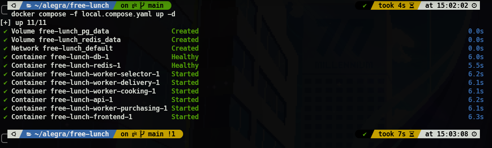

# INFORMACIÓN IMPORTANTE

Este repositorio es un clon remoto de un repositorio local de mi HomeLab, los procesos de testing, validación estática de código, procesos de compilación y despliegue a nube se evidencian solo desde mi instancia local de forgejo, en el video y capturas adjuntas se subirá esto.

## Cómo desplegar la aplicación en local, docker y docker swarm

Para todos los despliegues se requiere copiar el repositorio y abrir una consola en el root del mismo.

### Despliegue local usando Docker

Se requiere subir secretos y variables de entorno para la base de datos (/db), api (/api), brokers asíncronos (/brokers) y frontend (/front) dispuestos de la siguiente manera por la configuración del [local.compose.yaml](local.compose.yaml)

#### /db/secrets

- **db_name.txt**: Contiene nombre de la base de datos a crear en la instancia de PostgreSQL.
- **db_user.txt**: Contiene usuario de la base de datos a crear en la instancia de PostgreSQL.
- **db_password.txt**: Contiene contraseña de la base de datos a crear en la instancia de PostgreSQL.

El hash de contraseña de los usuarios **manager** y **operation** se pueden precargar usando el [db/init.sql](db/init.sql) para la tabla **users**.

#### /api/secrets/.env

Dentro de este .env se requieren las siguientes variables:

- **PORT**: Puerto para publicar la api, **3000** por defecto.
- **DB_HOST**: Host que tiene la instancia PostgreSQL, **db** según configuración del compose.
- **DB_NAME**: Nombre de la base de datos en la instancia PostgreSQL.
- **DB_USER**: Usuario de la base de datos en la instancia PostgreSQL.
- **DB_PASSWORD**: Contraseña de la base de datos en la instancia PostgreSQL.
- **REDIS_URL**: Url del redis, **redis://redis:6379** según configuración del compose.
- **JWT_SECRET**: Secreto para firma asimétrica del JWT de la Api

#### /brokers/secrets/.env

Dentro de este .env se requieren las siguientes variables:

- **DB_HOST**: Host que tiene la instancia PostgreSQL, **db** según configuración del compose.
- **DB_NAME**: Nombre de la base de datos en la instancia PostgreSQL.
- **DB_USER**: Usuario de la base de datos en la instancia PostgreSQL.
- **DB_PASSWORD**: Contraseña de la base de datos en la instancia PostgreSQL.
- **REDIS_URL**: Url del redis, **redis://redis:6379** según configuración del compose.
- **EXTERNAL_API**: Url externa para compra de ingredientes en el mercado, **https://recruitment.alegra.com/api/farmers-market/buy** según definición del reto.
- **BATCH_COUNT**: Procesamiento en concurrencia que deben simular los brokers que actuan como cocineros y encargados de entrega en la ventana, **10** por defecto dentro de los brokers, se recomienda un máximo de **20** para no sobrecargar en testing local.

#### frontend

Se pueden definir desde el [local.compose.yaml](local.compose.yaml)

- **PORT**: Puerto para publicar el frontend, **3000** por defecto con mapeo desde el compose **4000** en host.
- **BACKEND_URL**: URL de la API backend, **http://api:3000** por defecto para trabajar con la api del compose.

### Despliegue en ambiente de test usando Docker

Se recomienda uso de un proveedor de secretos o montaje de variables dinámico desde una interfaz de administración de docker (Portainer, Dockge, Dockhand, Dokploy).

El compose para este ambiente es [test.compose.yaml](test.compose.yaml).

#### Variables/Secretos

- **DB_HOST**: Host que tiene la instancia PostgreSQL, **db** según configuración del compose.
- **DB_NAME**: Nombre de la base de datos en la instancia PostgreSQL.
- **DB_USER**: Usuario de la base de datos en la instancia PostgreSQL.
- **DB_PASSWORD**: Contraseña de la base de datos en la instancia PostgreSQL.
- **REDIS_URL**: Url del redis, **redis://redis:6379** según configuración del compose.
- **JWT_SECRET**: Secreto para firma asimétrica del JWT de la Api
- **EXTERNAL_API**: Url externa para compra de ingredientes en el mercado, **https://recruitment.alegra.com/api/farmers-market/buy** según definición del reto.
- **BATCH_COUNT**: Procesamiento en concurrencia que deben simular los brokers que actuan como cocineros y encargados de entrega en la ventana, **10** por defecto dentro de los brokers, se recomienda un máximo de **100** para no sobrecargar ambiente de testing y realizar pruebas de carga.

### Despliegue en ambiente de productivo usando compose stack

Se recomienda uso de un proveedor de secretos o montaje de variables dinámico desde una interfaz de administración de docker (Portainer, Dockge, Dockhand, Dokploy).

El compose para este ambiente es [prod.compose.yaml](prod.compose.yaml).

- **DB_HOST**: Host que tiene la instancia PostgreSQL, **db** según configuración del compose.
- **DB_NAME**: Nombre de la base de datos en la instancia PostgreSQL.
- **DB_USER**: Usuario de la base de datos en la instancia PostgreSQL.
- **DB_PASSWORD**: Contraseña de la base de datos en la instancia PostgreSQL.
- **REDIS_URL**: Url del redis, **redis://redis:6379** según configuración del compose.
- **JWT_SECRET**: Secreto para firma asimétrica del JWT de la Api
- **EXTERNAL_API**: Url externa para compra de ingredientes en el mercado, **https://recruitment.alegra.com/api/farmers-market/buy** según definición del reto.
- **BATCH_COUNT**: Procesamiento en concurrencia que deben simular los brokers que actuan como cocineros y encargados de entrega en la ventana, **10** por defecto dentro de los brokers, se recomienda un máximo de **100** y usar sistema de replicas integrado en el administrador de contenedores desplegado.

## Particularidades del desarrollo:

1. Los **brokers** para simular trabajadores de cocina y delivery tienen un temporizador de entre 30 a 45 segundos para completar sus tareas, aún así se mantiene acceso desde API a esta funcionalidad para usuarios finales del sistema.
2. No se generan imagenes de docker públicas para generar un despliegue más rápido con interfaces de administración de contenerización (dockhand para test y dokploy para prod en mi caso) haciendo uso de las integraciones con repositorios git.
3. El testing se realiza en CI/CD privado de forgejo, los resultados estan en [tests.md](docs/tests.md)