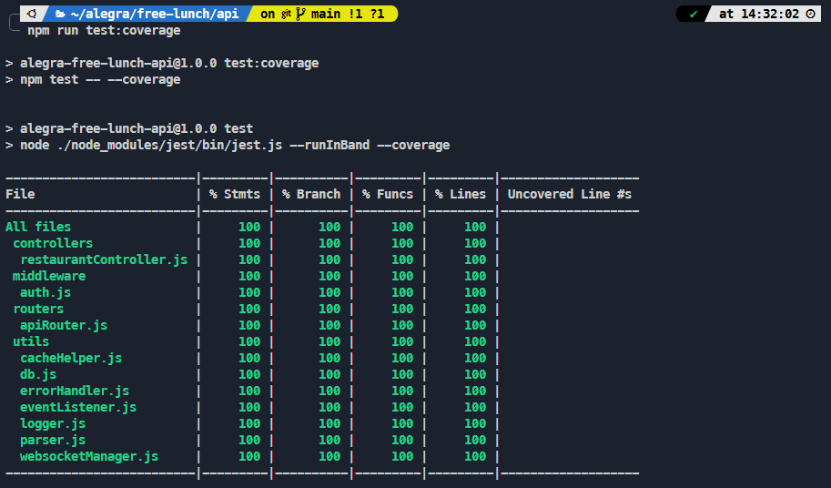
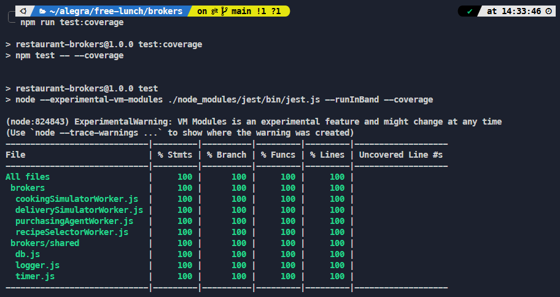
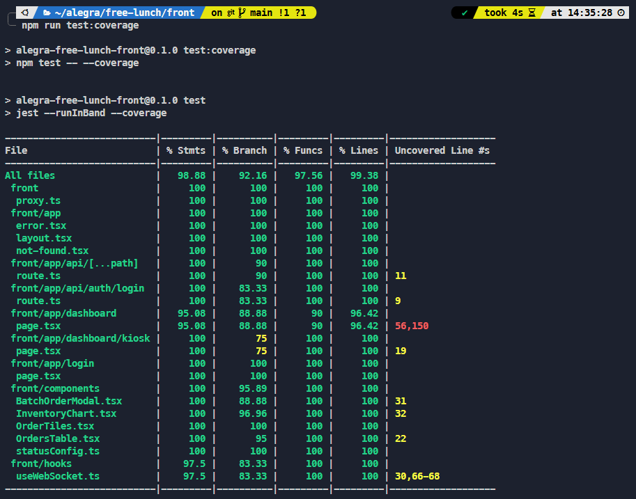
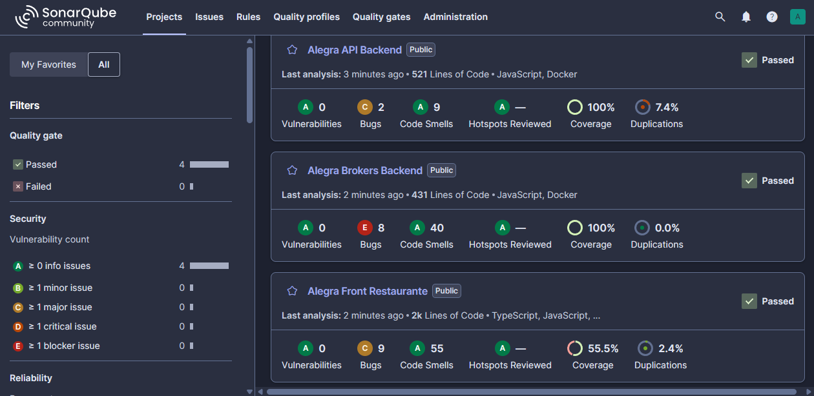
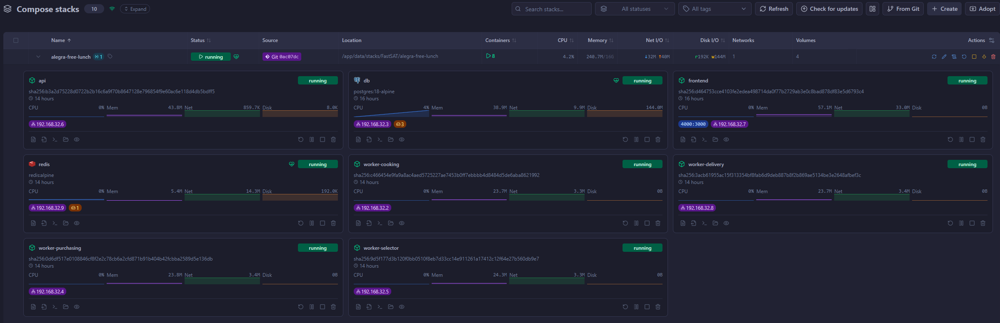
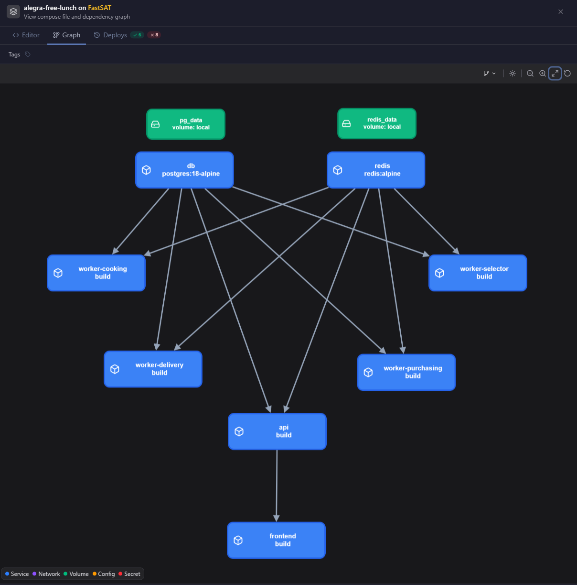
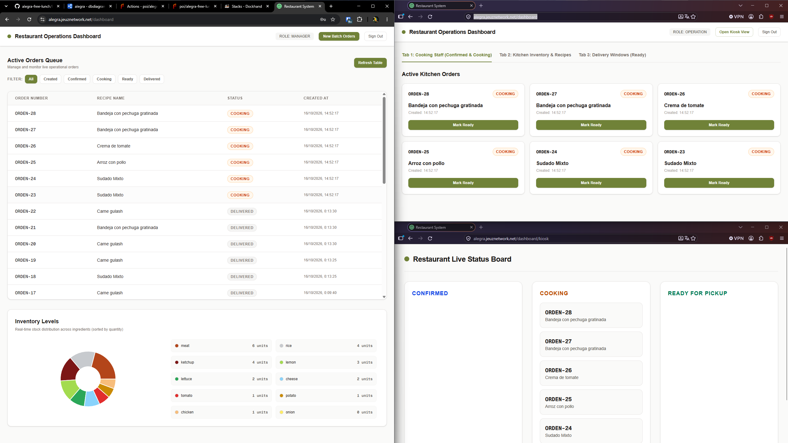

# Covertura de tests

## Test unitarios

### Api

### Brokers y asíncronos

### Front

## Analisis estático de código (SonarQube) y vulnerabilidades

## Despliegue en ambiente de testing privado

## Flujo de test automáticos

Todo el proceso integrado de testing se realiza cuando se generan pull request o push a la rama main del repositorio de git forgejo privado, los resultados se suben a la instancia SonarQube privada de mi homelab y posteriormente por integraciones de push se envía al repositorio externo de github, así como señal de actualización a la infraestructura conectada a este repo para despliegues automáticos.